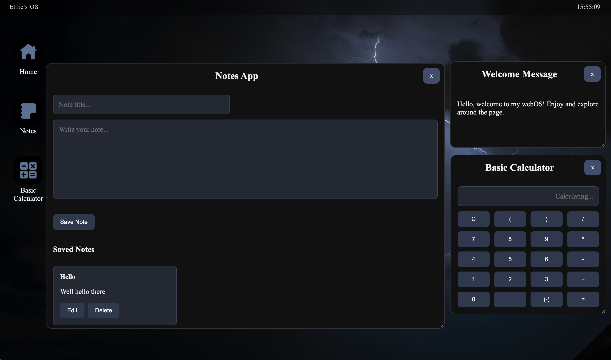

# WebOS
Here is a webOS styled around a simple and clean rainy vibe. 

### Demo Link 
https://elliewoodward2024-ops.github.io/WebOS/

### Features: 
- Basic Calculator 
- Notes app
- Draggable windows

#### References
 - The background was from Canva
 - Icon Images from Pinterest (don't know the owner of them though)

 

#### AI usage:
AI was only using to fix errors for my CSS and JS. Nothing else. 

